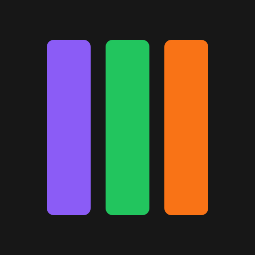
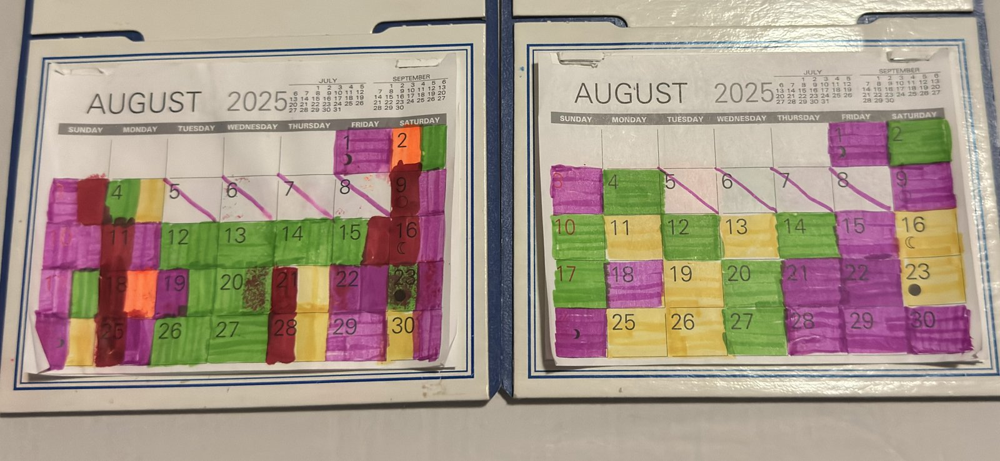
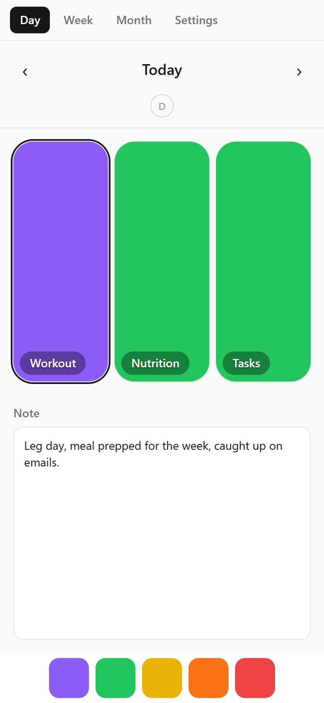
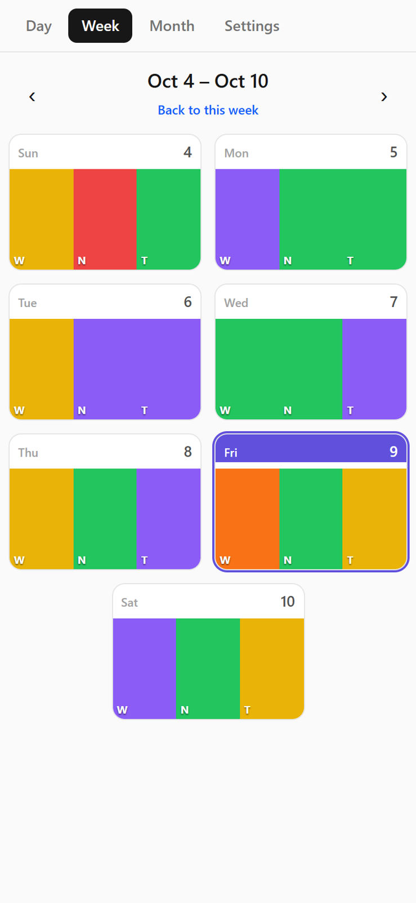
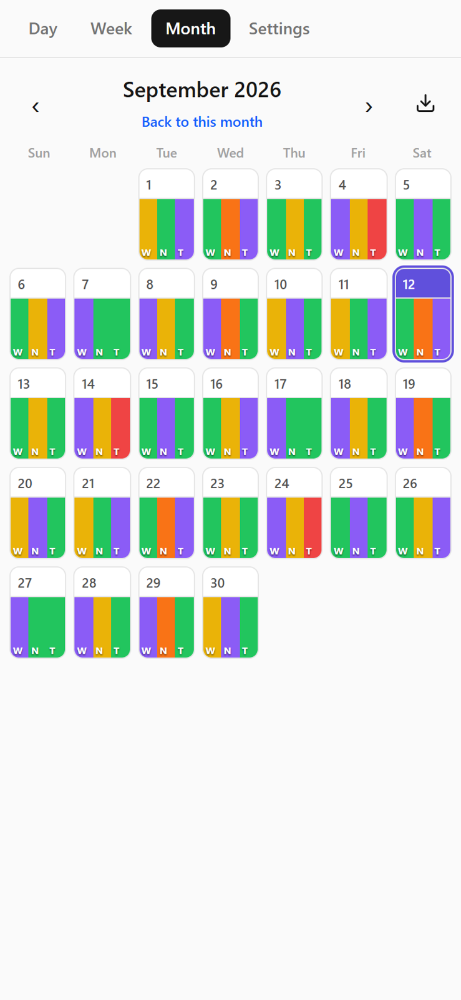
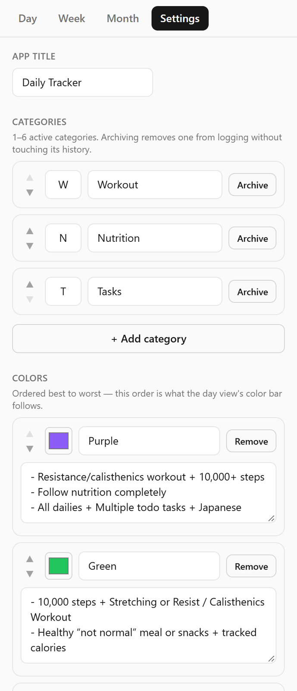

# Daily Habit Tracker

I built this app in Claude Code to replace my old paper calendar I used to track my daily habits in key areas of my life.

## Why I made it

Back in 2024 I heard a quote from James Clear's book Atomic Habits that stated: "If you can get 1 percent better each day for one year, you'll end up thirty-seven times better by the time you're done."
As a result I started keeping track of each day to make sure I was on the right track with my health and goals. I began with working out and nutrition, then added my daily task goal and step count after. On a physical calendar I colored each day Yellow, Green or Purple, with Purple meaning I overachieved. Later I added Orange and Red for rough days where I didn't achieve what I set out to.

Tracking kept me accountable, and I saw real improvement in my fitness and tasks I set out to finish. The paper version had problems though. The calendar ran out at the end of the year, my markers ran out of ink, sometimes I would forget to fill in the entries for a day or two which led to guessing, and hanging up a new month was a chore. So I needed a new solution.

## What it does

- Scores each day by category on a color scale I can edit.
- Lets me add my own categories and colors to better represent what I want to track and get a more accurate read of the day.
- Has a notes section and a discomfort journal for each day. I wanted to track not just my wins but my losses too, so bad days & habits don't stack up.
- Also shows a weekly and monthly view so I can see how I'm doing over time.
- Exports full data to JSON, which I use for my monthly/yearly recaps.
- Installs on my phone and works offline, so I can log on the go.

  
  
  

  

## Tech stack

- Frontend: React, TypeScript, Vite, Tailwind CSS
- Storage: IndexedDB, all on the device, no backend
- App shell: PWA, installable, works offline
- Hosting: Cloudflare Pages

## Building it with Claude

This was the first app that showed me what Claude was capable of. Initially I made the first version back in January and used it for a bit but it lacked a lot of the current functionality that's included today. It was just a simple artifact within Claude which worked as a proof of concept, but data would get wiped between builds since it was an artifact instead of a web app, plus it was dependent on Claude to run. Eventually I got it to where it is today and I use the app daily.
I stopped enjoying the process of programming because of the constant syntax errors and tiny fixes that it would require to get anything to run. Fighting through a bug feels good, but getting an idea off the ground feels better. With Claude I'm able to greatly reduce the time between an idea and a shipped product, workflow, or skill.
